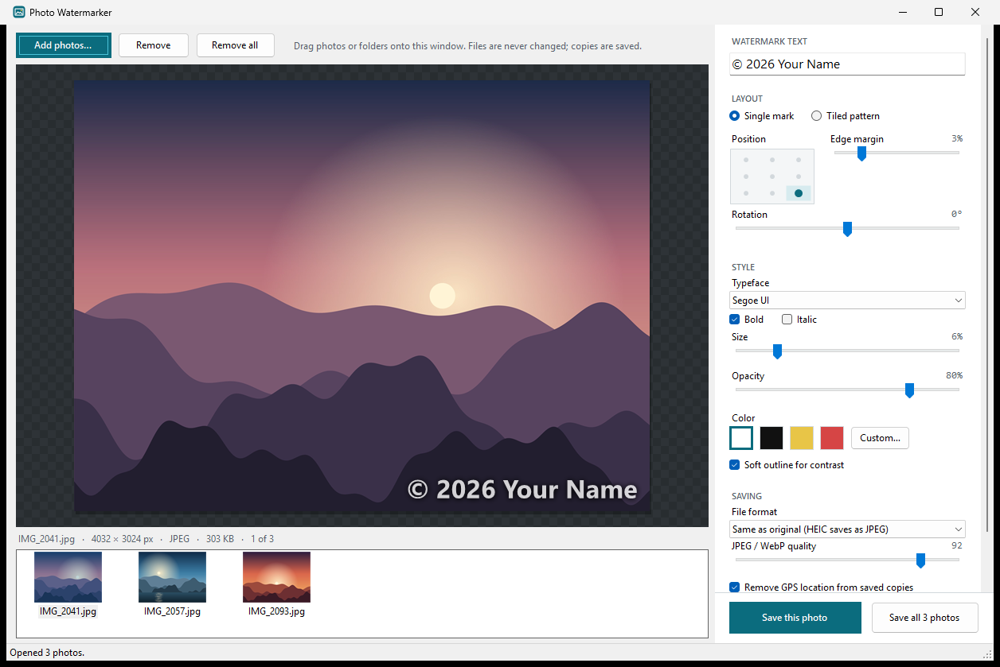

# Photo Watermarker

A Windows app for adding a text watermark to your photos, including iPhone HEIC files. Drag photos in, type your watermark, and save watermarked copies at full resolution.



## Features

- Drag photos or whole folders onto the window, choose them with Add photos, or paste an image with Ctrl+V.
- Opens JPEG, PNG, HEIC/HEIF, AVIF, WebP, TIFF, BMP, GIF and DNG. HEIC works without installing Microsoft's HEIF or HEVC extensions.
- Two layouts: a single mark in one of nine positions, or a tiled diagonal pattern that covers the whole photo and is hard to crop out.
- Live preview while you adjust the typeface, size, opacity, rotation, color, margin and spacing.
- An optional soft outline keeps the text readable on both light and dark parts of a photo.
- The watermark is sized relative to each photo, so a batch of photos with different resolutions looks consistent.
- Save one photo or the whole list in one click. Originals are never modified.
- Photos taken sideways on a phone are saved upright.
- Camera details and the date are kept in the saved copy. GPS location is removed by default.
- One self-contained `.exe` with no installer.

## Requirements

Windows 10 or 11, 64-bit. The app runs on .NET Framework 4.8, which is built into Windows.

## Getting started

1. Download `PhotoWatermarker.exe` from the latest release on this repository's Releases page, or build it yourself (see [Building](#building)).
2. Double-click `PhotoWatermarker.exe`. You can copy the file anywhere, for example to your desktop or another PC.
3. The first time you run it, Windows SmartScreen may say "Windows protected your PC" because the exe is not digitally signed. Click **More info**, then **Run anyway**.

You can also drag photos onto the exe (or a shortcut to it) to open the app with those photos already loaded.

## Using the app

1. Add photos by dragging them onto the window.
2. Type your watermark in **Watermark text**. To type the copyright symbol, hold Alt and type 0169 on the number pad.
3. Choose **Single mark** or **Tiled pattern**, then adjust the style. The preview updates as you go.
4. Click **Save this photo**, or **Save all photos** to watermark every photo in the list with the same settings.
5. Click **Show in folder** in the status bar to open the saved files.

The app remembers your settings for next time.

### Keyboard shortcuts

| Shortcut | Action |
| --- | --- |
| Ctrl+O | Add photos |
| Ctrl+V | Paste photos or an image from the clipboard |
| Ctrl+S | Save the photo shown |
| Ctrl+Shift+S | Save all photos |
| Delete | Remove the selected photos from the list (files are not touched) |
| Ctrl+A | Select all photos in the list |

### Where saved photos go

By default, each copy is saved in a `Watermarked` folder next to its original:

```
Pictures\Holiday\IMG_2041.heic
Pictures\Holiday\Watermarked\IMG_2041-watermarked.jpg
```

Use **Change folder** to save everything to one folder instead. Existing files are never overwritten. If a name is taken, the app adds a number, such as `IMG_2041-watermarked (2).jpg`. Images pasted from the clipboard are saved to `Pictures\Watermarked`.

### File formats

With **Same as original** selected:

| Original | Saved as |
| --- | --- |
| JPEG | JPEG |
| PNG, GIF, BMP | PNG (transparency is kept) |
| WebP | WebP |
| HEIC, HEIF, AVIF, TIFF, DNG | JPEG |

HEIC photos are saved as JPEG because the bundled image library can read HEIC but not write it. JPEG is also what most websites and apps accept. You can also choose JPEG, PNG or WebP for every photo, and set the JPEG and WebP quality (92 by default).

### Command line

The exe can watermark photos without opening the window, using the settings last saved in the app:

```
PhotoWatermarker.exe --render "(c) 2026 Your Name" "C:\Watermarked" photo1.heic photo2.jpg
```

The first argument after `--render` is the watermark text, the second is the output folder, and the rest are photos. It prints each saved path and exits with code 0 when every photo was saved, or 1 if any failed.

## Building

You need the [.NET SDK](https://dotnet.microsoft.com/download) 5.0 or newer. The first build downloads packages from NuGet, so it needs an internet connection.

```powershell
.\build.ps1
```

This builds the project and copies the result to `dist\PhotoWatermarker.exe` (about 27 MB). Close the app before rebuilding, because Windows locks an exe while it is running. To stamp a version number into the exe, run `.\build.ps1 -Version 1.2.0`.

### Continuous integration and releases

The GitHub Actions workflow in `.github/workflows/build.yml` runs on every push and pull request. It builds the exe on Windows and runs a smoke test that watermarks a sample image with the finished exe. Then it uploads the exe as a workflow artifact, which you can download from the run's summary page.

To publish a release, push a version tag:

```
git tag v1.2.0
git push origin v1.2.0
```

The workflow builds the exe with that version and creates a GitHub release named "Photo Watermarker 1.2.0". The release has the exe, a SHA-256 checksum file and release notes generated from the commits since the previous tag. Tags must look like `v1.2.3`.

## How it works

| File | Purpose |
| --- | --- |
| `src/MainForm.cs` | The window: photo list, preview, settings panel, drag and drop, saving |
| `src/WatermarkRenderer.cs` | Draws the watermark. The same code renders the preview and the full-resolution export |
| `src/ImageIO.cs` | Reads and writes images through Magick.NET, and carries over EXIF and color profiles |
| `src/PhotoItem.cs` | A photo in the list, plus the export step |
| `src/WatermarkSettings.cs` | Settings, saved to `settings.ini` |
| `src/Controls.cs` | The preview canvas, position picker and slider controls |
| `src/EmbeddedLibraries.cs` | Loads the libraries embedded in the exe |

Images are decoded with [Magick.NET](https://github.com/dlemstra/Magick.NET), which wraps ImageMagick and includes HEIC support. The watermark is drawn with GDI+. Only a screen-sized copy of each photo is kept in memory. The full-resolution image is decoded again from disk when saving, so large batches stay manageable.

To make a single exe, the Magick.NET assemblies and the native ImageMagick DLL are embedded as resources at build time. On first run, the native DLL is unpacked to `%LOCALAPPDATA%\PhotoWatermarker\native\`.

## Files the app creates

| Location | Contents |
| --- | --- |
| `%APPDATA%\PhotoWatermarker\settings.ini` | Your last-used settings |
| `%LOCALAPPDATA%\PhotoWatermarker\native\` | The image library, unpacked on first run (about 25 MB) |
| `%TEMP%\PhotoWatermarker\` | Images pasted from the clipboard, deleted when the app closes |

To remove the app completely, delete the exe and these folders.

## Third-party software

The exe includes [Magick.NET](https://github.com/dlemstra/Magick.NET) (Apache License 2.0) and [ImageMagick](https://imagemagick.org/script/license.php), along with the libraries ImageMagick bundles, such as libheif for HEIC. Their license notices are in `Notice.txt` in the Magick.NET NuGet package.

The screenshot above uses generated sample images.
